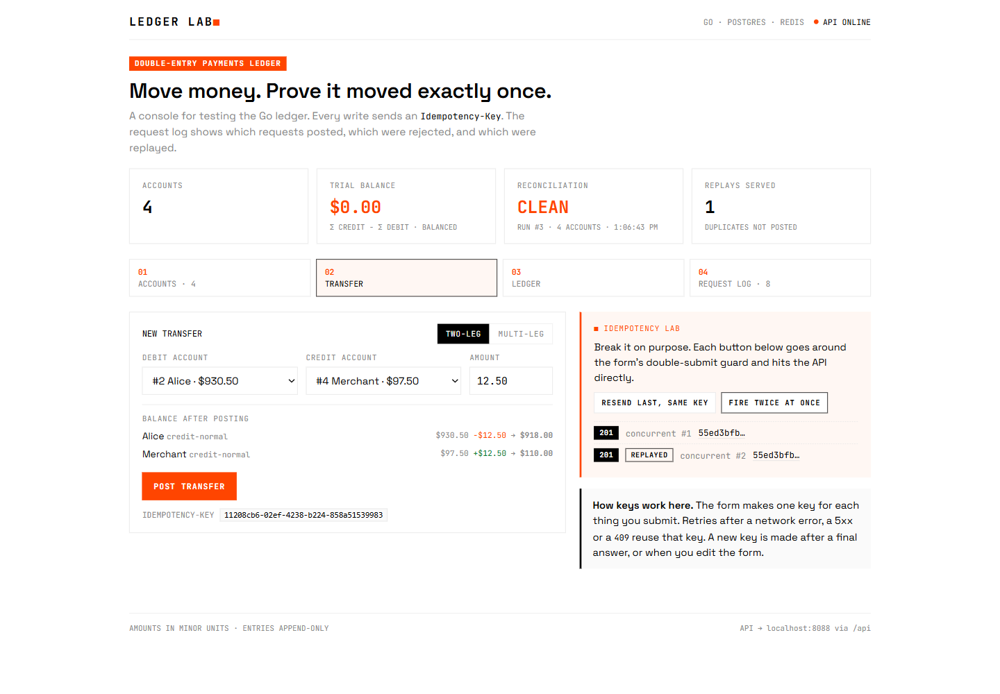
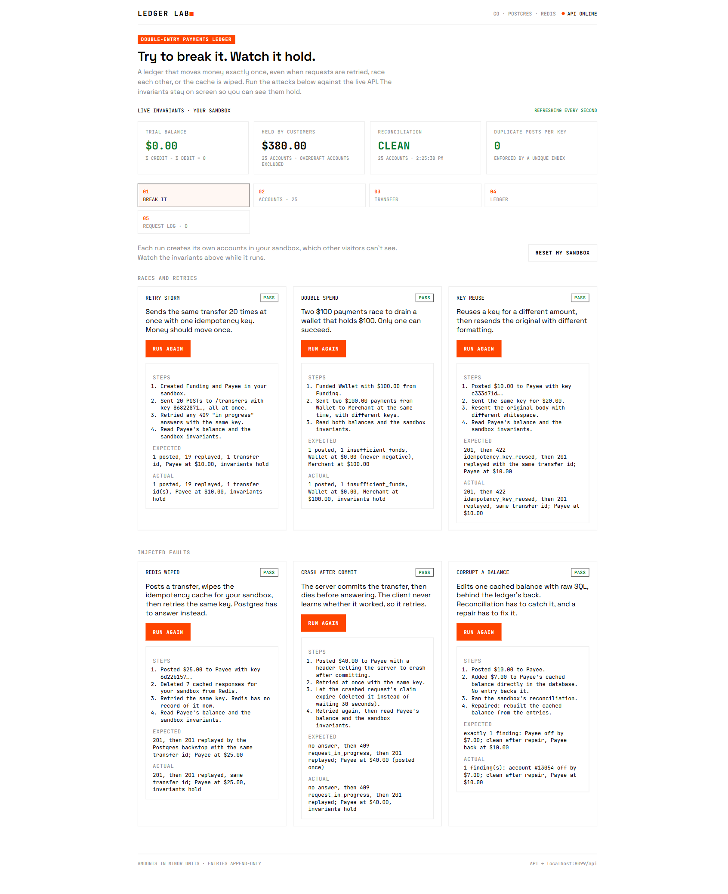
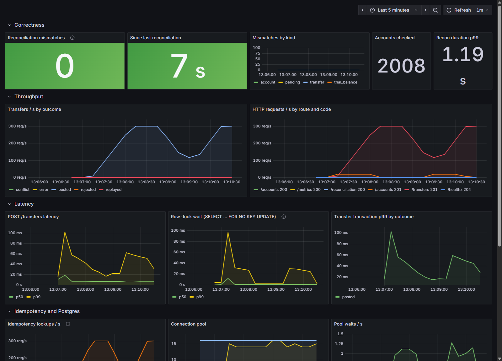

# go-ledger

A double-entry payments ledger in Go and Postgres, built to show payments correctness under concurrency and failure:

**Live demo:** https://go-ledger.onrender.com (free tier, so the first load can take about a minute to wake up). Try the console at `/`, or the API at `/api`.

- **Every transfer balances.** Multi-leg transfers post atomically. Debits equal credits, and accounts without an overdraft allowance never go negative.
- **Exactly-once posting.** Idempotency keys are enforced in two layers. Redis handles replays and in-flight duplicates. A Postgres backstop keeps the guarantee when Redis is down or flushed, and it covers rejected attempts too.
- **Concurrency without deadlocks.** Row locks are taken in id order. A rollup scheme removes the row-lock bottleneck on hot accounts (a merchant receiving most payments) without buffering money in memory.
- **Continuous reconciliation.** A background job checks every balance against the append-only entries in one snapshot, and alerts on any mismatch.
- **Reliable events.** A transactional outbox writes a `transfer.posted` event in the same transaction as the money movement. A worker publishes it to a Redis stream at least once, so no posted transfer goes unannounced, even across a crash.
- **Observable.** Prometheus metrics, a Grafana dashboard, alert rules and k6 load tests come with recorded results.

[DESIGN.md](DESIGN.md) covers how each guarantee is enforced and what happens when parts fail. [docs/results.md](docs/results.md) has the load-test measurements. [docs/hot-accounts.md](docs/hot-accounts.md) is a write-up of the hot-account problem and fix: one merchant's row lock slowed unrelated transfers 40x, and deferring only the cached balance brought merchant p99 from 1.67 s to 31 ms.



## Try to break it

The [live demo](https://go-ledger.onrender.com) opens on a **Break It** tab. Each visitor works in a private sandbox, and each scenario runs a real attack against the API:

- **Retry storm:** 20 identical requests at once, one idempotency key. One transfer posts; the rest replay it.
- **Double spend:** two payments race to drain a wallet that holds $100. One posts, one is declined, and the balance never goes negative.
- **Key reuse:** a key reused for a different amount is refused with `idempotency_key_reused`. The original request, reformatted, replays the first transfer.

Three more inject faults, using endpoints that only exist in a binary built with `-tags chaos` (the demo is one):

- **Redis wiped:** after a transfer posts, the sandbox's idempotency cache is deleted and the key is retried. Postgres replays the original transfer.
- **Crash after commit:** the server commits, then drops the connection without answering. The retry gets 409 while the dead request's claim lives, then the original transfer, never a second one.
- **Corrupt a balance:** one cached balance is edited with raw SQL. The sandbox's reconciliation names that account and the size of the drift, and a repair rebuilds the balance from its entries. The real reconciliation alert stays quiet, because the global worker skips sandboxes under a chaos experiment.

The invariants panel above the tabs (trial balance, held money, reconciliation, duplicate posts) polls the sandbox every second, and turns red while a balance is corrupted. [DESIGN.md](DESIGN.md#sandboxes-and-the-live-console) covers how sandboxes are isolated and limited.



## Results

All numbers are measured on one laptop, with the API, Postgres, Redis and k6 sharing it. They're good for comparing designs, not as capacity figures. Details are in [docs/results.md](docs/results.md).

| Workload | Rate | p50 | p99 | Notes |
|---|---|---|---|---|
| Transfers spread across 1,000 accounts | 300/s | 6.6 ms | 32 ms | saturates around 900/s on a 16-connection pool |
| 90% of transfers pay one merchant (ordinary account) | 300/s | 285 ms | 1.67 s | every payment waits on the merchant's row lock |
| Same, merchant marked hot | 300/s | 6.4 ms | 31 ms | lock-wait p99 drops from 846 ms to 1.8 ms |
| Same, merchant marked hot | 1,000/s | 10.7 ms | 232 ms | saturates at 879/s, the same ceiling as the spread-out load |

Reconciliation ran every 15 seconds through every load test and found 0 mismatches.

## Quick start

Needs Docker, Go 1.27+, Node 24 and make.

```sh
make up            # Postgres on :5433, Redis on :6379
make run           # API on :8088 (runs migrations, plus the recon and rollup workers)
```

In a second terminal:

```sh
make web-install   # once
make web           # test console on http://localhost:5173
```

Or with curl:

```sh
curl -X POST localhost:8088/accounts -d '{"name":"Funding","currency":"USD","normal_balance":"credit","allow_negative":true}'
curl -X POST localhost:8088/accounts -d '{"name":"Alice","currency":"USD","normal_balance":"credit"}'
curl -X POST localhost:8088/transfers -H 'Idempotency-Key: fund-alice-1' \
  -d '{"debit_account_id":1,"credit_account_id":2,"amount":10000}'
# Send the same request again: same transfer, with Idempotent-Replayed: true
```

## Deploy

[](https://render.com/deploy?repo=https://github.com/michael-jw-ji/go-ledger)

The `Dockerfile` builds one image with the API and the web console: the console is served at `/` and the API under `/api`. [`render.yaml`](render.yaml) is a Render Blueprint that creates that web service and a Redis-compatible Key Value store, both on free plans. Postgres comes from [Neon](https://neon.com)'s free plan, which doesn't expire; Render's free Postgres is deleted after 30 days.

1. Create a Neon project and copy its connection string with connection pooling turned **off** (the host must not contain `-pooler`). The API keeps its own connection pool, and the direct endpoint avoids any surprises with prepared statements.
2. Click the button above, or in Render choose New > Blueprint and pick this repo.
3. Paste the Neon string as `DATABASE_URL` when Render asks. Migrations run at startup, so there's nothing else to set up.

Things to know about the free plans:
- **Sleep.** The web service sleeps after 15 minutes without traffic, and the first request after that takes up to a minute while it wakes. The console says so while it waits. Neon suspends its compute once the app stops querying and wakes in under a second.
- **Redis is not persistent** on the free plan. A restart empties the idempotency cache (Postgres is the source of truth for keys, so retries stay safe) and the history of the `ledger.events` stream.
- **Open access.** The demo has no authentication, so anyone with the URL can create accounts and transfers. That's fine for a demo of fake money, but don't reuse it for anything real.

To run the same image locally: `docker build -t go-ledger . && docker run -p 8088:8088 -e DATABASE_URL=... -e REDIS_URL=... go-ledger`. The API also honors `PORT` when `ADDR` isn't set.

## Commands

| Command | What it does |
|---|---|
| `make up` / `make down` | Start or stop Postgres and Redis (`down` also stops the obs stack) |
| `make run` | Run the API on `:8088` |
| `make test` | Unit tests |
| `make test-integration` | Testcontainers suite against real Postgres and Redis (needs Docker). `LEDGER_PROP_ITERS=10000` scales the property test. |
| `make test-chaos` | The integration suite plus the fault-injection tests (`-tags integration,chaos`). CI runs this. |
| `make run-chaos` | The API with the fault-injection endpoints compiled in |
| `make lint` | `go vet` and golangci-lint (via Docker), for the default and the chaos build |
| `make recon` | One-off reconciliation; exits 1 on mismatches |
| `make obs` | Prometheus on `:9090` and Grafana on `:3000`, scraping `make run` |
| `make load-steady` / `make load-hot` | k6 via Docker. Override with `RATE=500 DURATION=2m`; `HOT=false` gives the hot test an ordinary merchant. |
| `make web` / `make web-test` | Test console dev server / Vitest suite |

The API reads `DATABASE_URL`, `REDIS_URL`, `ADDR`, `RECON_INTERVAL` (default `60s`), `ROLLUP_INTERVAL` (default `100ms`), `OUTBOX_INTERVAL` (default `200ms`) and `OUTBOX_STREAM` (default `ledger.events`). For a public deployment, `WRITE_RATE_PER_IP` turns on a per-IP write limit (writes per second; off by default), with `WRITE_BURST_PER_IP` (default `150`) and `RATE_LIMIT_PROXY_HOPS` (how many proxies add `X-Forwarded-For` entries; default `0`, which uses the TCP peer).

Events go to the Redis stream `ledger.events`, one message per posted transfer or reversal, with fields `event_id`, `type`, `aggregate_id`, `created_at` and `payload` (the transfer as JSON). Delivery is at least once, so dedupe on `event_id`. To watch it: `docker compose exec redis redis-cli XREAD BLOCK 0 STREAMS ledger.events $`.

## API

| Method | Path | Notes |
|---|---|---|
| `POST` | `/accounts` | `{name, currency, normal_balance: "debit"\|"credit", allow_negative, hot}` |
| `GET` | `/accounts`, `/accounts/{id}` | Balances include hot entries not yet rolled up |
| `GET` | `/accounts/{id}/entries?cursor=&limit=` | Newest first, opaque cursor |
| `POST` | `/transfers` | `Idempotency-Key` header required. Body: `{entries: [{account_id, direction, amount}]}` or the two-leg shorthand `{debit_account_id, credit_account_id, amount}` |
| `GET` | `/transfers/{id}` | |
| `POST` | `/transfers/{id}/reverse` | `Idempotency-Key` header required. At most one successful reversal per transfer. |
| `GET` | `/reconciliation` | Latest reconciliation run |
| `GET` | `/invariants` | Trial balance, held money and a scoped reconciliation for the sandbox in `X-Sandbox-Id`. Records nothing. |
| `POST` | `/sandbox/reset` | Archives the sandbox in `X-Sandbox-Id`; the client then uses a new id |
| `GET`, `POST` | `/chaos`, `/chaos/flush-redis`, `/chaos/corrupt-balance`, `/chaos/repair` | Chaos build only, scoped to the sandbox. `X-Chaos-Crash: after-commit` on `POST /transfers` drops the response after commit. |
| `GET` | `/metrics` | Prometheus |
| `GET` | `/healthz` | |

Amounts are integers in minor units (cents). Status codes:

| Status | Meaning |
|---|---|
| 201 | Posted |
| 422 | Rejected (`insufficient_funds`, `currency_mismatch`, `account_not_found`, `unbalanced`, `validation_error`, `idempotency_key_reused`, `not_reversible`) |
| 409 | `request_in_progress` (retry with the same key) or `already_reversed` |
| 404 | Unknown account or transfer |
| 400 | Malformed body or missing key |

A rejected transfer is recorded, so retrying its key returns the same 422. A request rejected by validation (400, `unbalanced`, `validation_error`) never reached the ledger and doesn't use up its key. A retry must resend the same request: formatting may differ, but values and shape may not.

## Observability



`make obs` provisions the dashboard above. Its rows cover correctness (reconciliation), throughput, latency (including row-lock wait), idempotency and the connection pool, the hot-account rollup, and the outbox. Prometheus alert rules fire on any reconciliation mismatch, on recon going stale, on a rollup backlog, and on outbox lag.

## Testing

- **Integration tests** run against real Postgres 16 and Redis 7 via Testcontainers. They cover overdrafts, reversals, rejection replay, concurrent duplicate keys, every Redis-layer state and failure mode, reconciliation detecting a corrupted balance, and hot-account lock behavior.
- **A property test** sends random multi-leg transfers from 64 goroutines, retrying 20% of keys (half concurrently). It checks conservation of money, balances against entries, one transfer per key, and agreement of every response for a key. During the run it reconciles a fresh snapshot every 25ms. A variant wipes Redis every 100ms.
- **The web console** has Vitest and Testing Library tests: a double click posts once, retries reuse the key, and a 409 is retried automatically.
- **CI** (GitHub Actions) runs gofmt, golangci-lint, unit tests and integration tests with `-race`, plus the web typecheck, tests and build.

## Layout

```
cmd/ledger/            API server and the `recon` subcommand
internal/ledger/       domain types, validation, posting logic (Postgres transactions)
internal/idempotency/  Redis key store and HTTP middleware
internal/recon/        reconciliation checks and worker
internal/rollup/       hot-account rollup worker
internal/outbox/       transactional outbox publisher (Redis stream)
internal/metrics/      Prometheus collectors and hook adapters
internal/httpapi/      routes, JSON, error mapping
migrations/            goose SQL migrations, embedded and run at startup
test/integration/      Testcontainers tests and the property test
loadtest/              k6 scripts
deploy/                Prometheus config and alerts, Grafana provisioning and dashboard
web/                   React + TypeScript test console
```

Stack: Go with pgx (no ORM), goose, go-redis, client_golang, Testcontainers. Postgres 16, Redis 7. React 19, Vite, TanStack Query, Vitest.
